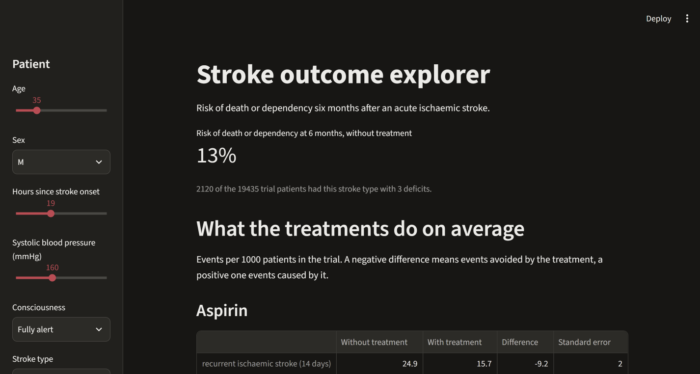
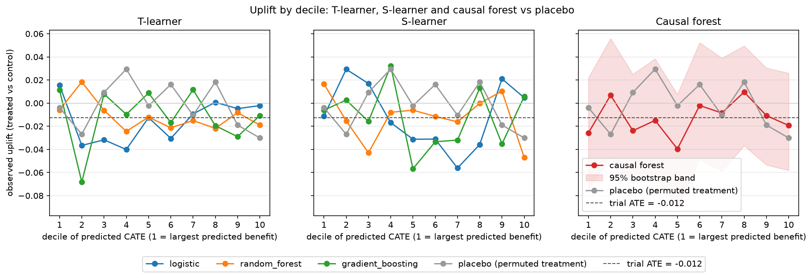

# Personalized Treatment Effects

Can the effect of aspirin and heparin in acute ischaemic stroke be personalised? An analysis of the International Stroke Trial (IST).

## Results

**Baseline risk can be predicted.** A logistic regression on 23 features known at
randomisation predicts death or dependency at 6 months with an AUC of 0.79 to 0.81 on
the test set.

**The treatment effect cannot be personalised.** T-learner, S-learner and causal forest
were compared with cross-fitted CATE estimates, uplift by decile, a placebo with permuted
treatment and a bootstrap band. No learner orders patients by their response better than
chance, for aspirin or for heparin, and the hint found on the training set did not
replicate on the test set.

**Average benefits and harms per 1000 patients treated** (standard error in brackets):

| Outcome | Aspirin | Heparin |
|---|---|---|
| Recurrent ischaemic stroke (14 days) | −9.2 (2.0) | −5.2 (2.0) |
| Haemorrhagic stroke (14 days) | +1.3 (1.3) | +8.1 (1.3) |
| Major non-cerebral bleed (14 days) | +5.3 (1.3) | +9.5 (1.3) |
| Death or dependency (6 months) | −12.5 (7.0) | +0.3 (7.0) |

Heparin prevents recurrent strokes but causes as many bleeds, so its net effect is zero.
Aspirin keeps a small net benefit.

## Data
Download version 2 of the IST database from https://datashare.ed.ac.uk/handle/10283/124
and save `IST_corrected.csv` in `data/raw/`.

Note: this project uses `IST_corrected.csv` (version 2, corrected), not the file attached
to the original 2011 paper, which contains errors in some date variables.

The raw file is encoded in Windows-1250 (month abbreviations are in Polish, e.g. `paź`);
it is converted to UTF-8 in `data/interim/` before loading.

## Data pipeline
1. `notebooks/01_data_loading.ipynb`: converts the raw file to UTF-8 (`data/interim/`)
2. `notebooks/02_data_checking.ipynb`: data quality checks on the raw data
3. `uv run python scripts/clean.py`: cleans the data (`data/processed/ist_clean.parquet`)
4. `notebooks/03_cleaned_data_check.ipynb`: checks the cleaned data
5. `uv run python scripts/build_features.py`: builds the model features (`data/processed/ist_features.parquet`)

## Analysis
6. `notebooks/04_first_models.ipynb`, `05_risk_models.ipynb`: risk models (logistic regression, AUC 0.80)
7. `notebooks/06_cate_learners.ipynb`: T-learner, S-learner and causal forest for aspirin
8. `notebooks/07_heparin.ipynb`: the same analysis for heparin
9. `notebooks/08_test_set.ipynb`: final evaluation on the test set
10. `notebooks/09_benefit_harm.ipynb`: average effects on every outcome

Main result: baseline risk can be predicted well and the average effect of each
treatment can be estimated, but the data do not support personalising the treatment effect.

## App
1. `uv run python scripts/train_app_models.py`: fits the risk model and saves it in `models/`
2. `uv run streamlit run app.py`: opens the app in the browser

The app shows a patient's risk of death or dependency at 6 months and the average
benefits and harms of aspirin and heparin. It warns when the stroke type and the number
of deficits entered were never observed together in the trial. It is an educational
tool, not for clinical use.

## Setup
uv sync